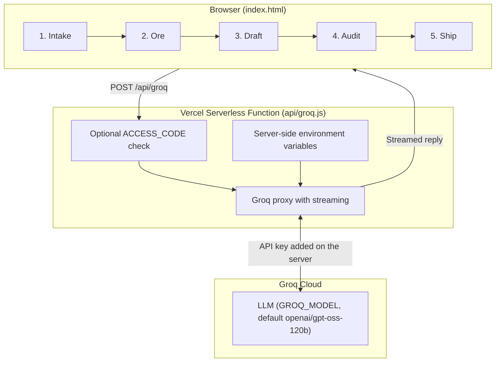

<div align="center">

# 🔨 SpecSmith
### Raw Company Documents → Traceable Software Requirements Specification

[](https://vercel.com/)
[](https://groq.com/)
[](https://nodejs.org/)
[](https://developer.mozilla.org/en-US/docs/Web/HTML)
[](#-overview)

*An AI web app that forges emails, meeting notes, SOPs and RFPs into a structured, source-traceable SRS in five guided steps.*

[Features](#-key-features) • [Workflow](#-the-five-step-workflow) • [Architecture](#-system-architecture) • [Quick Start](#-quick-start) • [Deploy](#-deploy-on-vercel) • [API](#-api-endpoint)

</div>

---

## 🌍 Overview

Requirements rarely arrive in a clean list. They are scattered across email threads, meeting notes, standard operating procedures and tender documents. Turning that pile into a proper Software Requirements Specification by hand is slow, and the link between each requirement and the document it came from usually gets lost along the way.

**SpecSmith** solves this by combining four ideas in one small app:
1. **Guided five-step workflow:** Intake, Ore, Draft, Audit and Ship take you from raw text to a finished specification.
2. **Traceability:** Every requirement is tied back to the source material it was derived from.
3. **Streaming Groq inference:** Replies stream in as they are generated, using `openai/gpt-oss-120b` by default (configurable).
4. **Safe by default:** Your API key lives only on the server, and an optional access code stops strangers from spending your quota.

---

## ✨ Key Features

- 🧾 **Document-to-SRS pipeline:** Paste in raw company documents and get an SRS structured along the lines of ISO/IEC/IEEE 29148.
- 🔗 **Traceable requirements:** Each requirement can be checked against its source during the Audit step.
- ⚡ **Streaming output:** The server proxy streams Groq's reply straight to the page, so you see the draft as it is written.
- 🎚️ **Selectable depth:** Choose **Quick** depth for a faster, lighter draft when working with many or very long documents.
- 🔐 **Server-side API key:** `GROQ_API_KEY` never appears in the page or the repository.
- 🚪 **Optional access code:** Set `ACCESS_CODE` and visitors must enter it before they can use the app.
- 📦 **Tiny footprint:** One HTML file and one serverless function, no separate backend to run.

---

## 🔨 The Five-Step Workflow

| Step | Name | What happens |
| :---: | :--- | :--- |
| **1** | **Intake** | Add your raw documents and choose the depth of the analysis. |
| **2** | **Ore** | Requirement candidates are mined from the source text. |
| **3** | **Draft** | The candidates are written up as a structured SRS. |
| **4** | **Audit** | The draft is checked and each requirement is traced back to its source. |
| **5** | **Ship** | Review the result and export the finished specification. |

---

## 🧱 System Architecture



---

## 🔐 Security Model

- The browser only ever talks to `/api/groq`. It never sees your Groq key.
- `GROQ_API_KEY` is read from environment variables on the server (Vercel dashboard in production, `.env` locally).
- `.env` is git-ignored so the key is never committed.
- Set `ACCESS_CODE` on any public deployment so strangers cannot burn through your Groq quota.
- If a key ever leaks, revoke it in the [Groq Console](https://console.groq.com/keys), create a new one and update it in Vercel.

---

## 📂 Repository Structure

```text
srs-ai/
├── index.html        # The app: five-step UI (front end)
├── api/
│   └── groq.js       # Server proxy that streams Groq's reply
├── .gitignore        # Keeps .env, .vercel and node_modules out of Git
└── README.md         # Project documentation
```

---

## ⚙️ Environment Variables

| Variable | Required | Description |
| :--- | :---: | :--- |
| `GROQ_API_KEY` | ✅ | Your key from the [Groq Console](https://console.groq.com/keys). |
| `GROQ_MODEL` | ➖ | Groq model to use. Defaults to `openai/gpt-oss-120b`. |
| `ACCESS_CODE` | ➖ | If set, visitors must enter this code before using the app. |

---

## 🚀 Quick Start

### Prerequisites
- **Node.js** `v18+`
- **Git**
- A free **Groq API key** from the [Groq Console](https://console.groq.com/keys)
- *(For deployment)* a **Vercel** account

### 1. Clone the Repository
```bash
git clone https://github.com/KiranJITdesign/srs-ai.git
cd srs-ai
```

### 2. Add Your Environment Variables
Create a `.env` file in the project root:
```env
GROQ_API_KEY=your_groq_api_key
# GROQ_MODEL=openai/gpt-oss-120b
# ACCESS_CODE=choose_a_code
```
Make sure `.env` is in your `.gitignore`:
```text
.env
.env.*
.vercel
node_modules
```

### 3. Run Locally
```bash
npx vercel dev
```
The first run asks you to log in to Vercel and link the project. Then open the address it prints (usually `http://localhost:3000`).

> 💡 **Why `vercel dev`?** The AI call goes through `api/groq.js`, which needs a server to run. Opening `index.html` directly, or serving it from a static host, will load the page but the AI will not respond.

---

## 🌐 Deploy on Vercel

1. Push this folder to https://github.com/KiranJITdesign/srs-ai
2. On [vercel.com](https://vercel.com) choose **Add New > Project**, import the repo, then open **Environment Variables**.
3. Add `GROQ_API_KEY`. Optionally add `GROQ_MODEL` and `ACCESS_CODE`.
4. Click **Deploy**.

To change a variable later, edit it under **Settings > Environment Variables** and redeploy.

> ⚠️ **GitHub Pages alone will not work.** It only serves static files and cannot run `api/groq.js`. Use Vercel, or Netlify with `api/groq.js` ported to a Netlify Function.

---

## 🔌 API Endpoint

| Method | Endpoint | Description |
| :--- | :--- | :--- |
| `POST` | `/api/groq` | Server proxy. Checks the access code when `ACCESS_CODE` is set, calls Groq using the server-side key, and streams the reply back to the browser. |

---

## 🧰 Troubleshooting

| Problem | Fix |
| :--- | :--- |
| Error about a missing or invalid key | Check that `GROQ_API_KEY` is set in Vercel (or `.env` locally), then redeploy or restart `vercel dev`. |
| App keeps asking for an access code | Enter the exact value you set as `ACCESS_CODE`, or remove the variable to turn the check off. |
| Request times out on a long draft | Choose **Quick** depth or add fewer documents. |
| Page loads but the AI never responds | You are probably on a static host such as GitHub Pages. Deploy on Vercel instead. |

---

## 🔮 Future Scope

- 📥 Direct upload and parsing of PDF and DOCX source documents.
- 📤 One-click export of the finished SRS to Word or PDF.
- 💾 Saved projects and version history for each specification.

---

## 📄 License

Distributed under the MIT License. Built for engineers who would rather build than write requirements by hand.
